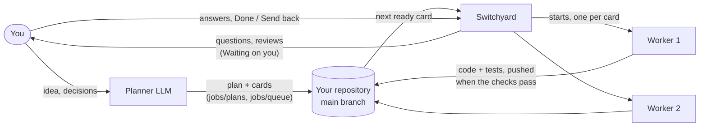

# Getting started: from nothing to a first finished card

This page is a tutorial. Follow it from top to bottom and you will:

1. understand what ProjectToolkit is for and how its parts work together;
2. install it;
3. set up a small example project, **Notes**, a command-line app that keeps short notes;
4. write its design, then have a planner LLM write the project's plan from it: the centre of the work;
5. set up the workers and start Switchyard, and see the plan on its page;
6. have the planner turn the plan's first step into job cards;
7. watch AI workers take the cards, answer a question one of them asks, and accept a finished piece of work;
8. learn where to find everything afterwards.

Every command on this page has been run as shown, in a scratch copy of the example. Where you click something,
the page names the button exactly as it is labelled. When you want more detail on any part, the
[guide's index](README.md) lists every tool and the page that covers it.

Allow an hour for the first pass, most of it reading. You need a Windows PC and an account with an AI coding agent.

---

## 1. What the toolkit is, and the way of working it supports

ProjectToolkit lets **one developer** build software with **several AI agents working at the same time**, without
the agents getting in each other's way and without you having to watch them all the time. It has three parts:

- **A project layout.** Every project has the same folders (`code/`, `test/`, `docs/`, `jobs/` and a few more), so
  people and agents always know where things belong.
- **A job queue.** The `jobs/` folder in your repository. Each piece of work is a **card**: a short Markdown file
  saying what to do and how to know it is done. A card moves through folders as work progresses:
  `queue/` (waiting to start), `active/` (being worked on), then `done/` (finished and checked) or `review/`
  (finished, but you need to look at it).
- **The scheduler**, called **Switchyard**. A program on your PC that watches the queue, starts one AI **worker** per
  card, checks the work, and shows everything on a web page where you watch and steer it. A small icon in the
  Windows notification area (the tray) keeps it running.

There are four roles:

| Who | What they do | Example in this tutorial |
|---|---|---|
| **You, the developer** | Decide what to build, answer questions, accept or send back results. | "I want a notes app with `add` and `list`." |
| **The planner** | An LLM you talk to (a chat assistant or agent session with access to the project folder). It turns your ideas into a plan and the plan into cards. It does not write the product's code. | It writes `jobs/plans/notes_plan.md` and the cards. |
| **Workers** | AI agent sessions started by Switchyard, one per card, each in its own copy of the repository. A worker does exactly one card, runs the project's checks, and pushes. | A worker writes the `add` command and its tests. |
| **Switchyard** | Hands cards to workers, moves cards between folders, keeps the main branch healthy, shows you what is happening. | The page at `http://localhost:8766/`. |



The **project's plan** is the centre of all of this. It is one Markdown file, written from your design, that says
where the project is going and the steps that get it there; every card the workers do hangs from one of its steps. The
**Plans** view of Switchyard is where you see and steer the project, and the **Workers** view is where the action
happens, the live windows of the workers doing the cards. That is why this page has you write the design and the plan
(section 4) before you set up the workers.

Why work this way:

- **Small cards finish.** An agent given one well-described task with a clear "done when" succeeds far more often
  than one given a whole feature. The planner's job is to cut work into such cards.
- **Workers can't trample each other.** Each worker has its own git worktree (a separate folder with its own
  checkout), and each card has a **scope**: the files it may change. Two cards that would touch the same files do
  not run at the same time.
- **Main stays green.** Before pushing, a worker must pass the project's **gates** (for Notes: build with warnings
  as errors, then run the tests). Switchyard also checks main itself after pushes, and stops starting new work while
  main is broken.
- **Everything is in git.** Every card move is a commit, so the history of every piece of work can be read back
  later, and nothing lives only in an agent's memory.
- **You stay in charge.** When a worker needs a decision, it does not guess: it parks the card with a question, which
  shows up on the page under **Waiting on you**.

---

## 2. Install

### Requirements

- **Windows 10 or 11** with **Windows PowerShell 5.1** (built in) or PowerShell 7.
- **Git for Windows** (`git --version` should work in a new terminal).
- **The .NET 10 Desktop Runtime, x64.** Switchyard is written in C# on .NET 10; it needs the runtime, not the
  SDK. The installer checks for it and, when it is missing, points at
  [dotnet.microsoft.com/download/dotnet/10.0](https://dotnet.microsoft.com/download/dotnet/10.0)
  ("Desktop Runtime, Windows x64").
- **The .NET 10 SDK**: for this tutorial's example project, which you build with `dotnet`, and for building
  Switchyard if you take the clone path (`dotnet --version` should print `10.0.something`). With the installer,
  skip it if your own projects use another stack.
- **An AI agent command line** that Switchyard can start for each worker. The four supported agents are
  the **GitHub Copilot CLI** (`copilot`), **Claude Code** (`claude`), **OpenAI Codex CLI** (`codex`) and
  **OpenCode** (`opencode`). New projects come set up for the first two: the Copilot CLI on GitHub's own
  models (the pool's default worker type) and Claude Code. This tutorial uses Claude Code: install it, run `claude` once and log in, so
  that it can run without asking you anything.
- **OpenAI Codex CLI** (optional; needs npm from Node.js). It works against OpenAI's own service, so it
  needs an account or a key: a ChatGPT subscription (Plus, Pro or Business) signed in with `codex login`
  (opens a browser), or an API key with `codex login --with-api-key` (it reads the key from stdin).
  Install: `npm install -g @openai/codex` — the install page:
  [github.com/openai/codex](https://github.com/openai/codex). Check: `codex --version`, then
  `codex login status` (a worker is never asked to sign in, so do it yourself first).
- **OpenCode** (optional; also npm). It needs its models from somewhere: a provider sign-in
  (`opencode auth login`) or the provider's API key (`OPENAI_API_KEY`, `ANTHROPIC_API_KEY`, ...), or —
  with no key at all — its own free models (`opencode models` lists them) or a local OpenAI-compatible
  endpoint, which is how it runs the same local model server as the Copilot CLI above.
  Install: `npm install -g @opencode/cli` — the install page:
  [opencode.ai](https://opencode.ai). Check: `opencode --version`, then `opencode models`.

To use Codex or OpenCode as a worker, add the agent's entry under `agents` in the project's
`jobs\scheduler.json` and a worker type that names it: [switchyard.md, worker types](switchyard.md#7-worker-types-and-models).

### Install with the installer

Download **`ProjectToolkit-Setup.exe`** from the toolkit's GitHub releases page (the newest is always at
`<the toolkit's repository URL>/releases/latest/download/ProjectToolkit-Setup.exe`) and run it.

- **SmartScreen:** the installer is not code-signed, so Windows may show "Windows protected your PC" with no
  **Run** button. Click **More info**, then **Run anyway**.
- **Where it goes:** a per-user install into `%LOCALAPPDATA%\Programs\ProjectToolkit`, with no admin prompt. The
  folder page lets you pick another folder, and you can choose to install for all users instead.
- **Two checkboxes, both off by default:**
  - *Start Switchyard when I sign in*: starts Switchyard when you log in.
  - *Add the bin folder to my PATH (so projecttoolkit.ps1 can be run by name)*: puts the kit's `bin` folder on your
    user PATH. This guide writes every command with the
    kit's full `bin` path, as if you left it unticked; ticking it shortens them to `projecttoolkit.ps1 ...`
    (open a new terminal afterwards, so PATH is re-read).
- **Runtime and git checks:** the installer checks for the .NET 10 Desktop Runtime and for `git` on PATH and, on a
  page titled "Before you start Switchyard", names the download for whichever is missing. Neither check stops the
  installation; install what it names and carry on.
- **PowerShell scripts:** the installer does not change your execution policy, and the files it writes carry no
  "downloaded from the internet" mark, so the normal `RemoteSigned` policy runs them as they are. If
  `projecttoolkit.ps1` is refused anyway, run `Set-ExecutionPolicy -Scope CurrentUser RemoteSigned` in PowerShell
  and try again.

The installer adds a **Switchyard** shortcut to the Start menu. Don't start it yet: Switchyard needs the
**pool file** — the list of projects it runs — which step 3.1 creates. Start it in [step 5.2](#52-start-switchyard).

### The second path: build from a clone

Instead of the installer you can run the toolkit from a clone of its repository, whose `main` branch is the released code, and build
Switchyard yourself in [step 5.2](#52-start-switchyard). Projects never copy the toolkit into themselves; they
point at it, whichever form it has.

```powershell
git clone <the toolkit's repository URL> C:\Projects\ProjectToolkit
```

---

## 3. The example project

Our example is **Notes**, a tiny command-line program:

```text
> notes add "buy milk"
Added note 1.
> notes list
1  buy milk
```

It will live in `C:\Projects\Notes`. Right now it only exists as an idea; by the end of this page a worker will have
written its first command.

### 3.1 Create the project

Run `projecttoolkit.ps1` with `-Action new-project`. In an installed kit the script lives in the kit's `bin`
folder, so give its full path (the guide assumes you left *Add the bin folder to my PATH* unticked at install):

```powershell
& "$env:LOCALAPPDATA\Programs\ProjectToolkit\bin\projecttoolkit.ps1" -Action new-project -Repo C:\Projects\Notes `
    -Categories "A=app:code/src/,test/" `
    -Gate "dotnet build code\src\Notes.slnx -warnaserror;;dotnet test code\src\Notes.slnx --no-build"
```

If you ticked that box, open a new terminal and drop the path: `projecttoolkit.ps1 -Action new-project ...`.
Working from a clone instead, the script is `C:\Projects\ProjectToolkit\bin\projecttoolkit.ps1`.

What the parameters mean:

- `-Repo` is where the project goes. The folder is created, and becomes a git repository (branch `main`).
- `-Categories` names the kinds of work and the files each one owns. A **category** is a letter, a name and a list
  of folders; only one card of a category runs at a time, so two workers never edit the same files. One category
  (`A`, "app", owning `code/src/` and `test/`) is right for a small project. You can add more later.
- `-Gate` gives the **gates**: the commands every worker must pass before pushing, separated by `;;`. They also
  become the project's **health check**, the command Switchyard runs to see whether main is green.

You should see (shortened):

```text
git repository created in C:\Projects\Notes
== canonical layout in C:\Projects\Notes
created  .gitignore
created  .gitattributes
created  README.md
created  docs/conventions.md
created  docs/design/gdd/Notes.md
created  docs/design/tdd/Notes-technical.md
== job queue in C:\Projects\Notes
created  docs/known_gaps.md
created  jobs/README.md
created  jobs/card-template.md
...
created  jobs/categories.json
created  jobs/models.json
created  jobs/project.md
created  jobs/scheduler.json
== scheduler pool
created  C:\Users\<you>\AppData\Local\ProjectToolkit\pool.json (with the pool defaults) and added Notes
         the running pool picks Notes up at its next tick once this project's jobs/ is pushed to main

Notes is set up in C:\Projects\Notes with the canonical layout and a job queue. Next:
  1. Fill in README.md ...
```

The script ends with a numbered list of next steps; this tutorial walks you through them. (If you ever run the script
from inside a worker, or in a temporary folder, it prints `skipped  the pool join: ...` instead and leaves the pool
file alone. That is deliberate.)

### 3.2 What it made

```text
C:\Projects\Notes
├── README.md, .gitignore, .gitattributes
├── assets\               art, data and other inputs that are not code
├── bin\                  the project's own scripts
├── code\src\             the source code (empty for now)
├── code\extern\, code\lib\, code\tools\, extern\bin\
├── docs\
│   ├── conventions.md    the project's coding rules (fill this in)
│   ├── known_gaps.md     things known to be missing or wrong
│   ├── design\gdd\Notes.md            what the program must do
│   ├── design\tdd\Notes-technical.md  how it does it
│   └── reference\
├── jobs\                 the job queue
│   ├── README.md         the rules every worker follows (from the toolkit; don't edit)
│   ├── project.md        this project's gates, locations and standing instructions
│   ├── categories.json   the categories and the files each owns
│   ├── scheduler.json    this project's scheduler settings (agents, health check, time limits)
│   ├── models.json
│   ├── card-template*.md, plan-template.md
│   ├── queue\  active\  review\  done\   the cards, by state
│   ├── plans\            every plan, from draft to done: the project's plan first (section 4)
│   ├── archive\, attachments\, requests\
├── out\                  build output (not committed)
└── test\                 tests
```

Three files are worth opening now:

- `jobs\project.md` lists the gates you gave. Workers read it after `jobs\README.md`.
- `jobs\scheduler.json` has `"project": "Notes"` (it must match the name in the pool file) and the health check:
  `"command": "dotnet build code\\src\\Notes.slnx -warnaserror && dotnet test code\\src\\Notes.slnx --no-build"`.
  (Run from Windows PowerShell 5.1, each `&` is written as `\u0026`, which JSON reads as the same `&&`.)
- `jobs\categories.json` has category `A`. Its `"purpose"` is empty: write one line there, for example
  `"The notes program and its tests."`, so the planner knows what the category is for.

### 3.3 Give the gates something to check

The gates build and test `code\src\Notes.slnx`, which does not exist yet, so main would be red (broken) from the
start and Switchyard would not start any work. Create an empty solution with a console app and a test project:

```powershell
cd C:\Projects\Notes
dotnet new sln -n Notes -o code\src
dotnet new console -n Notes -o code\src\Notes
dotnet new xunit -n Notes.Tests -o test\unit\Notes.Tests
dotnet sln code\src\Notes.slnx add code\src\Notes\Notes.csproj test\unit\Notes.Tests\Notes.Tests.csproj
dotnet add test\unit\Notes.Tests reference code\src\Notes
```

The generated `.gitignore` ignores compiled files by extension (`*.exe`, `*.dll`, ...) and the .NET build
folders under `code\` and `test\` (`code/**/bin/`, `code/**/obj/`, `test/**/bin/`, `test/**/obj/`), so your
first commit takes no build files. The patterns are scoped to those two folders because a project's
top-level `bin\` holds scripts you do want committed.

Now run the gates yourself, exactly as a worker will:

```powershell
dotnet build code\src\Notes.slnx -warnaserror
dotnet test code\src\Notes.slnx --no-build
```

You should see `0 Error(s)` from the build and `Passed!  - Failed:     0, Passed:     1, ...` from the tests (the
xUnit template comes with one empty test).

### 3.4 A remote, and the first push

Workers push their work to the `origin` remote's `main` branch, and Switchyard reads the queue from there, so the
project needs a remote. Any git server works (GitHub, a company server). To keep everything on your PC, a bare
repository in a folder is enough:

```powershell
git init --bare C:\Projects\Notes.git
git add -A
git commit -m "Notes: layout, job queue and an empty solution"
git remote add origin C:\Projects\Notes.git
git push -u origin main
```

The last line should end with `* [new branch]      main -> main`. Check that `git status` now reports nothing to
commit.


## 4. The design and the project's plan

This is one of the most important first steps. Everything the workers do later hangs from the project's plan, and the
plan is written from your design, so the order is: create the project (section 3), write the design, then have a
planner write the plan. Cards and workers come after, from section 5.

You could write cards by hand from `jobs\card-template.md`, but the intended way is to work with a **planner**: an
LLM session that can read and write files in `C:\Projects\Notes`. You describe what you want; it asks you what it
needs to know, writes the plan, and later cuts the plan into cards a worker can finish in one session.

How to set a planner up, the brief to paste at the start of every planner session, and many example exchanges are
in the planner guide, [planner.md](planner.md). Here is the short version.

### 4.1 Write the design

The master design document is `docs\design\gdd\Notes.md`. Step 3.1 created it as a skeleton with twelve numbered
sections. It says what the program is, what it must do and what it must not. It is your document: a planner may help
you draft it, but its decisions are yours, and workers read it and never decide it. Open it and fill in what you
know. For a program as small as Notes a line or two under each heading is enough; here are the parts that matter
most (the other sections are filled in the same way, or deleted):

```markdown
# Notes - Design

Status: draft v0.1 · Owner: me · See also [conventions](../conventions.md) and
[the technical design](../tdd/Notes-technical.md)

## 1. High concept

Notes is a command-line program that keeps short notes in a text file. You add a note with one command and see all
your notes with another, so a thought takes seconds to write down and is easy to find again.

## 5. Rules and values

- `notes add "<text>"` appends the text as a new note and prints `Added note <n>.`, where `<n>` is the note's number.
  The first note is 1, and numbers go up by one.
- `notes list` prints every note, one per line: the number, two spaces, then the text.
- A note's text may contain spaces and is kept whole.
- Notes are kept in a text file, one note per line.
- Notes never changes or deletes a note that was already written.

## 11. Open questions

None.
```

The last rule is a **must not**; say those out loud, because a planner can only plan around what the design says.
When the design is written, commit it (the commit and push come at the end of 4.3).

### 4.2 Start the planner and brief it

Open a terminal in `C:\Projects\Notes` and start your agent there (for Claude Code: `claude`). Paste the starter
brief; the project already has a copy of it at `docs\planner-brief.md`, and [planner.md](planner.md) explains it. In
short, it tells the planner to read `jobs\README.md`, `jobs\project.md`, `jobs\plans\` and the cards first, to keep
plans in `jobs\plans\`, to name new cards `new-<L>-<slug>` and leave the numbers to Switchyard, and to ask you before
deciding anything that is yours to decide.

### 4.3 Have the planner write the project's plan

Tell the planner to read your design and write the project's plan. For example:

> Read docs\design\gdd\Notes.md. Write the project's plan from it, as the root plan, and the technical design it
> needs. Don't card anything yet.

A good planner asks before it guesses. Expect a question like *"Where should the notes file live: beside the program,
or in the user's profile?"* Answer it, or say you'd rather have the worker ask (you will see how that looks in
section 7). For this tutorial, say you would rather the worker asks. The planner writes your answer into the plan
under **Decisions**, dated, in your own words. Anything the planner only suggests is not a decision, and does not go
there.

The planner then writes:

1. **The technical design**, `docs\design\tdd\Notes-technical.md` (how the program does it): for Notes, a `NoteStore`
   class that reads and appends the file, and a `Program` that parses the command. Your design wins over it on what
   the program does.
2. **The project's plan**, `jobs\plans\notes_plan.md`. This is the project's **root plan**: it has no `Parent:` line,
   and a project normally has just one. It starts as `Status: draft`, has a Goal, and then one numbered `##` step per
   piece of the work, each with Delivers, Done when, Depends on and Tasks. The exact fields are in
   [plans.md](plans.md) and the template is `jobs\plan-template.md`. For Notes it is short:

   ````markdown
   # Plan: Notes keeps short notes and shows them back

   Status: draft
   Goal: `notes add "<text>"` and `notes list` work from the command line, and the unit tests for them pass.
   Why: This is the project's root plan: it is how the program in docs/design/gdd/Notes.md gets built.
   Scope: category A (code/src/Notes, test/unit/Notes.Tests).
   Out of scope: changing or deleting notes, and anything beyond the commands in the design.
   Inputs: docs/design/gdd/Notes.md, docs/design/tdd/Notes-technical.md.

   ## Decisions

   - 2026-11-24 10:15 (developer): the notes are kept in a text file, one note per line. Where the file lives is not
     decided yet: the worker asks me when it gets there.

   ## Open questions

   None.

   ## 1. Add notes

   Delivers: `NoteStore.Add` and the `notes add "<text>"` command, which prints `Added note <n>.`.
   Done when: the unit tests show the first note is 1, the second is 2 and text with spaces is kept whole, and the
   gates pass.
   Depends on: none
   Estimate: 60 min
   Tasks:
   - notes add: NoteStore.Add, the command and their tests (A, Claude)

   ## 2. List notes

   Delivers: `NoteStore.All` and the `notes list` command, which prints `<n>  <text>` for each note.
   Done when: the unit tests show a list of two notes prints both, in order, and an empty file prints nothing, and the
   gates pass.
   Depends on: step 1
   Estimate: 60 min
   Tasks:
   - notes list: NoteStore.All, the command and their tests (A, Claude)

   ## 3. Write the usage into the README

   Delivers: the README's "Usage" section shows both commands with their output.
   Done when: running the README's two examples in a fresh checkout prints what the README says.
   Depends on: step 2
   Estimate: 30 min
   Tasks:
   - README usage (A, Claude)
   ````

   Only a `##` heading that starts with a number is a step, so `## Decisions` and `## Open questions` are not steps.
   A plan never lists card numbers: the Plans view finds a step's cards by the `Plan:` line on each card.

3. **A check before it is carded.** Read the plan against the checklist in section 6 of [plans.md](plans.md). The Notes
   plan passes: the Goal is one sentence and says how it is checked; there are no open questions; each step is a verb
   and an object, with Delivers, Done when and Tasks; its one decision is dated and says who made it; Scope and Out of
   scope are filled in; and, as the project's root, it has no parent step to find. Tell the planner when you are
   happy with it, and it sets `Status: ready to card`.
4. **The commit.** The design and the plan go to main, and you commit and push them: `git add -A`,
   `git commit -m "Notes: design and the project's plan"`, `git push`. The planner does not push to git: its brief
   has it hand changes to Switchyard through the **planner outbox**, which is off until you turn it on (see
   [planner.md](planner.md)); until then, commit what it writes yourself.

Nothing reaches the workers yet: there are no cards. The plan is on main, and you can read it as the project's map.

---

## 5. Set up the workers and start Switchyard

### 5.1 The pool file: which projects run, and which agents work on them

The pool file is `%LOCALAPPDATA%\ProjectToolkit\pool.json`. It belongs to your PC, not to any repository. Step 3.1
created it; open it in an editor:

```json
{
  "about": "The scheduler's pool: the projects it serves and the worker types it runs.",
  "projects": [
    { "name": "Notes", "repo": "C:\\Projects\\Notes", "weight": 50 }
  ],
  "port": 8766,
  "listen": "lan",
  "remoteControl": true,
  "pool": {
    "maxWorkers": 8,
    "types": {
      "Copilot": { "max": 2, "agent": "" },
      "Claude":  { "max": 2, "agent": "claude", "model": "claude-sonnet-5-5" }
    },
    "defaultWorker": "Copilot"
  }
}
```

- `projects` lists every project Switchyard runs. `weight` shares the workers between projects when there are
  several.
- `port` is where the page is served: `http://localhost:8766/`. `listen` is `lan` (other PCs on your network may
  open the page; `remoteControl` lets them press its buttons) or `localhost` (this PC only). For a first try,
  `"listen": "localhost"` and `"remoteControl": false` are the safer choice.
- `pool.types` are the **worker types**: which agent and model a worker runs, and how many of each may run at once
  (`max`). The pool's `defaultWorker` type takes every card with no `Worker:` line; any other type takes only cards that
  name it (a `Worker: Claude` line on the card).

This tutorial uses Claude Code, so make it the default: set `"defaultWorker": "Claude"`, and if the GitHub Copilot CLI
is not installed and signed in, set the Copilot type's `max` to `0`. The `Claude` type runs Claude Code
(`"agent": "claude"` names the `claude` entry under `agents` in the project's `jobs\scheduler.json`, which says how to
start it) and, as the default, takes every card with no `Worker:` line. The `Copilot` type runs the GitHub Copilot CLI
on GitHub's own models (no model server) and then takes only cards that say `Worker: Copilot`.

**Optional: a local model server.** To run the Copilot CLI against your own OpenAI-compatible server, create the
project with `-Endpoint <the server's /v1 address> -Model <its model name>` (they are written into the project's
`jobs\scheduler.json`), or add a type of your own to the pool file and point a worker at it. It is off by default;
nothing in a new project's files names a local server.

Worker types, weights and the rest of the file are explained in [switchyard.md](switchyard.md).

### 5.2 Start Switchyard

In an installed kit the scheduler is already built. Open **Switchyard** from the Start menu. It starts with every
project in the pool file and puts the Switchyard icon in your tray. (The installer's finish page offers
*Start Switchyard* too, but only once a pool file exists — on a fresh install you start it from here on.)

If you took the clone path in step 2 instead, build it and start it from the clone:

```powershell
cd C:\Projects\ProjectToolkit
.\bin\build-and-deploy.ps1 -NoPull
```

This builds the scheduler into `C:\Projects\ProjectToolkit\out\windows\scheduler\`, starts it with every project in
the pool file, and starts the tray icon. (`-NoPull` deploys the version you cloned. Without it the script first
updates the toolkit from its `main` branch, which is meant for the toolkit's own development.) The first build
takes a minute or two.

Either way, when it finishes your browser opens the page at `http://localhost:8766/`. If it does not, double-click the
Switchyard icon in the tray, or right-click it and choose **Open page**. You should see:

- a title bar reading **Switchyard v**_version_, with **Pause all**, **Drain and exit** and **Stop all and exit**;
- a view selector showing **Plans**, the view the page opens on when it has none remembered (the other choices are
  **Workers** and **Gantt**);
- the **Plans** window, with your project's plan in it (section 5.3).

Switch the view selector to **Workers** to see the **Projects** table with a row for **Notes**. Its **Health** column
first says `main not checked yet`, then `checking <commit> (n min)` while it runs your gates, and then
`main <commit> green at <time>`.

The queue is empty, so nothing else happens yet.

Switchyard keeps running in the background. The tray icon's menu has **Open page**, **View log**,
**Restart Switchyard**, **Update and restart**, **Exit, leave workers running** and **Exit (stop all)**. In an
installed kit **Update and restart** reads **Check for update...** and opens the latest release's page: download
the new `ProjectToolkit-Setup.exe` and run it — the installer stops the running Switchyard, swaps the files and
starts it again, and your workers keep running.

Adding another project later needs no restart: run
`& "$env:LOCALAPPDATA\Programs\ProjectToolkit\bin\projecttoolkit.ps1" -Action new-project` (or `-Action jobs` for an
existing repository), push it, and Switchyard picks it up at its next check of the pool file (about a minute).
While it joins, its row says `starting...`.

### 5.3 The Plans view: the project's plan on the page

The page opened on the **Plans** view: it opens on the view you left it at, and on Plans when there is none. The
**Plans** window shows, per project, every plan in `jobs\plans\` as a checklist: each step with its cards, marked
✓ (complete), ☐ (not yet) or ✗ (cancelled or errored), and a `done/total` count. Click a step to read that section of the plan,
or a card to read it (a card in review opens its review page). Cards that belong to no plan are listed under
**No plan**. A finished plan stays in the list, collapsed.

With more than one project in the pool, a second selector next to the view selector filters to one project.

The same view selector has a third choice, **Gantt**, which draws the past and running work on a timeline with a
**Details** window beside it (below it on a narrow screen).

For Notes you now see one plan, `notes_plan.md`, with its three steps (**Add notes**, **List notes** and **Write the
usage into the README**) and no cards under them yet. This is the view you come back to most: it is where you see how
far the project has got. The **Workers** view, which you will use in section 7, is where the cards are worked.

---

## 6. Card the first step

Ask the planner to card step 1 of the plan, and only step 1: a plan is carded one step at a time, so what the first
cards teach you can change the later steps before they are carded.

> Card step 1 of the plan.

The planner writes a card for each of the step's Tasks (here one, `notes add`). It does not choose card numbers: it
writes each card as `new-<category>-<short name>.md`, here `new-A-notes-add.md` in `jobs\queue\`, and Switchyard gives
each the next free number once it is on main, renaming it to `<number>-<category>-<short name>.md` (here
`1-A-notes-add.md`) and fixing `Depends on` lines to match. Numbers only ever go up, so two writers never take the
same one. Here is card 1, **before** any work, as it looks once numbered:

```markdown
# 1-A: notes add

Category: A
Status: ready
Depends on: none
Locks: none
Time box: 60 min
Plan: jobs/plans/notes_plan.md, step 1
Type: feature

## Task

Add `NoteStore` (code/src/Notes/NoteStore.cs) with `int Add(string text)`, which appends the text as one line to
the notes file and returns the note's number (1 for the first). In Program.cs, `notes add "<text>"` calls it and
prints `Added note <n>.`. Where the notes file lives is not settled: ask.

Scope: code/src/Notes/, test/unit/Notes.Tests/

## Done when

- Tests in test/unit/Notes.Tests cover: first note is 1, the second is 2, text with spaces is kept whole.
- The gates pass.

## Questions

## Result
```

`Status: ready` means a worker may take it. `Scope` lists the files the worker may change. `## Questions` and
`## Result` are filled in by the worker. The `Plan:` line is what ties the card to its step: the Plans view finds the
step's cards by it, so the cards appear under step 1 there. A card for step 2 would say `Depends on: 1-A`, which keeps
it waiting until card 1 is finished.

The cards go to main like the plan did: `git add -A`, `git commit -m "jobs: card step 1 of the Notes plan"`,
`git push` (or, once the planner outbox is on, Switchyard commits the planner's batch). Nothing reaches the workers until it is pushed to main.

---

## 7. Watching it run

Step 1 of the plan is now a card in the queue, and the **Workers** view is where it gets done.

### 7.1 A worker takes the card

Within a minute or two of the push, Switchyard numbers the new cards, sees `1-A-notes-add` in `queue/` with
`Status: ready`, moves it to `active/` and starts a worker. Every step is a commit on main; after a `git pull`,
`git log --oneline` shows lines such as:

```text
jobs: start 1-A-notes-add
```

On the page (view **Workers**), a **worker window** appears below the Projects table. Its title bar reads like:

```text
Notes  Claude (claude-sonnet-5-5) - 1-A-notes-add          ▮▮▯▯▯▯  7/60 min
```

That is: the project, the worker type and model, the card (click it to read the card), and a bar showing how much of
the card's time box has been used. While the worker is busy you also see its speed (`T/s avg`); if it has printed
nothing for a while, `quiet N min` appears.

The window's body is the worker's **live log**: what the agent says it is doing and the commands it runs. Workers are
told to narrate each step in a sentence, so you can follow along. Under the log:

- a box **Message to this worker** with a **Send** button. Your message reaches the worker after its next step,
  and appears in the log as `<< you: ...`. Use it to steer ("use the user's profile folder for the notes file");
- **Minimize** folds the log away; **Stop** asks the worker to stop at a safe point; **Kill** ends it at once.
  Either way the card then waits under **Waiting on you** with **Resume**.

The worker runs in its own folder, `C:\Projects\Notes-workspaces\slot1`, so your own checkout in `C:\Projects\Notes`
is never touched. Its full log is also saved to disk (see [section 8.2](#82-the-logs)).

### 7.2 The health check

Each time a worker pushes, Switchyard runs the health check (your gates) on the new main in a separate folder
(`C:\Projects\Notes-workspaces\health`). The **Health** column shows `checking ...`, then `main <commit> green at
<time>`. If it says `RED`, see [section 8.4](#84-when-something-goes-wrong). You can run it at any time with the
**Check main** button on the project's row.

### 7.3 A question in "Waiting on you"

Our card said the notes file's location is not settled, so the worker asks rather than guessing. It writes the
question into the card, sets the card to `Status: needs-human: ...`, ends its session, and the card stays in
`active/`. The card's `## Questions` section now holds:

```markdown
- Q1: Found: the notes file needs a home, and the card leaves it open. Question: where should the notes file
  live? [in my user profile, %USERPROFILE%\notes.txt -> active | beside the program -> active | leave it to the
  planner -> queue]
```

A window titled **Waiting on you** appears in the **Workers** view, under the Projects table, with one row per card
that needs you. This row
shows the project (**Notes**), the card, the word `question`, and the question with one button per choice:
**in my user profile, %USERPROFILE%\notes.txt**, **beside the program** and **leave it to the planner**. (The
`-> active` part is not shown on the button; hover over it to see where the card goes.)

Click **in my user profile, %USERPROFILE%\notes.txt**. Switchyard writes your answer into the card, at the end
of the question's last line:

```markdown
  planner -> queue] -> **in my user profile, %USERPROFILE%\notes.txt** (developer, <date> <time>)
```

commits it, and, because that choice ends in `-> active`, sets the card back to `Status: ready`. A new worker
picks it up and reads your answer in the card.

Each row also has a **note (optional)** box and **Save note**: text you type there goes into the card under a
`## Dev` heading, which every worker reads first and must follow. Use it when none of the choices fits ("use
%APPDATA%\Notes\notes.txt instead") and then press **Resume** to put the card back to work. **Open** opens the card
file in your editor.

### 7.4 A review

When the work is finished, the worker either finishes the card (`done/`) or, if something needs your hands or eyes,
puts it in `review/` with `Status: review: <what to check>`. Suppose it wrote:

```text
Status: review: run `notes add "buy milk"` twice and check the second says "Added note 2."
```

The card appears in **Waiting on you** as `review`, with **Open**, **Done** and **Send back**. (It appears only once
the worker's session has ended.) Try it in a fresh checkout:

```powershell
cd C:\Projects\Notes
git pull
dotnet run --project code\src\Notes -- add "buy milk"
dotnet run --project code\src\Notes -- add "call the garage"
```

```text
Added note 1.
Added note 2.
```

- If it is right, click **Done**: the card moves to `done/`.
- If not, type what is wrong in the note box (for example "the second note printed 1"), then click **Send back**:
  the note goes into the card's `## Dev` section and the card goes back to `active/` as `ready` for another worker.

### 7.5 Done

With card 1 in `done/`, step 1 is ticked in the Plans view. Ask the planner to card step 2, and its card for
`notes list`, which depends on card 1, goes the same way.
Here is card 1 **after** the work, in `jobs\done\1-A-notes-add.md` (the task and the rest are unchanged):

```markdown
# 1-A: notes add

Category: A
Status: done
Claimed: <date>, lane A
...

## Questions

- Q1: Found: the notes file needs a home, and the card leaves it open. Question: where should the notes file
  live? [in my user profile, %USERPROFILE%\notes.txt -> active | beside the program -> active | leave it to the
  planner -> queue] -> **in my user profile, %USERPROFILE%\notes.txt** (developer, <date> <time>)

## Result

- <date> <time>: NoteStore.Add and `notes add` written test-first; 3 tests (first is 1, second is 2, spaces
  kept). Parked on Q1 (where the file lives). Next: the file location.
- <date> <time>: Q1 answered: the file is %USERPROFILE%\notes.txt. Gates pass (build, 4 tests). Pushed
  a1b2c3d. Done.
```

The Result is the worker's **journal**: a line per step with what was done, what was verified, and the commits. It
is the first thing to read when you want to know what happened to a card.

That is the whole cycle: idea, design, plan, cards, workers, questions, review, done, and then the next step.

---

## 8. Finding things later

### 8.1 The Plans view

The Plans view is described in [section 5.3](#53-the-plans-view-the-projects-plan-on-the-page): the page
opens on it unless you left it on another view; choose **Plans** in the view selector to find any plan, step or card again.

### 8.2 The logs

| What | Where |
|---|---|
| Switchyard's own log | `%LOCALAPPDATA%\ProjectToolkit\pool\scheduler.log` (the tray's **View log** shows the same lines live, in a window); one file per day in its `logs\` folder, kept 7 days |
| One project's scheduler log | `%LOCALAPPDATA%\Notes\scheduler\scheduler.log` |
| A worker's full log | `%LOCALAPPDATA%\Notes\scheduler\<number>-<category>-<yyyyMMdd>-<HHmmss>.log`, for example `1-A-20261123-101500.log`, beside the prompt the worker was given (same name, `.prompt.txt`) |
| A worker's live log | Its window on the page while it runs |
| A health check | The `log` link in the project's Health column |

### 8.3 A card's history

Every state change of a card is a commit on main: the scheduler's `jobs: start`, the worker's `jobs: journal`
lines, `jobs: review` or `jobs: done`, and your answers. To read a card's whole story, whichever folder it is in now:

```powershell
git log --format="%h %ad %s" --date=short -- "jobs/*/1-A-*"
```

```text
d4e5f6a 2026-11-23 jobs: done 1-A-notes-add
a1b2c3d 2026-11-23 Notes: notes add writes to the user's notes file
...
9f8e7d6 2026-11-23 jobs: start 1-A-notes-add
```

The card file itself (Questions, Dev notes, Result) is the summary; `git log` is the detail.

### 8.4 When something goes wrong

| What you see | What it means | What to do |
|---|---|---|
| Health says `main <commit> RED at <time>`; the project's state is `paused: main is red` | The gates fail on main. Switchyard starts no new work on this project; running workers carry on. | Click the `log` link to see why. Ask the planner to card a fix (or fix it yourself and push). The next green check resumes work by itself. |
| `stuck` in Waiting on you | A card failed more times than the project allows (`maxRetries` in `jobs\scheduler.json`, 2 by default), or ended without updating its card. | Read its `log` link and the card's Result. Improve the card (with the planner, or a note), then click **Retry**. |
| `waiting` in Waiting on you | A worker sent the card back to the queue (`Status: waiting: ...`), usually for the planner. | Read the reason in the card. When it is dealt with, click **Ready**. |
| A worker window says `quiet 20 min` | The agent has printed nothing for a while. | Send it a message asking where it is. If it stays silent, **Stop** (clean) or **Kill**. The card then waits under **Waiting on you**; press **Resume** to put it back to work. |
| Nothing starts, and main is green | Check the card: `Status: ready`? Every `Depends on` card done? Pushed to main? And the pool: does a worker type have `max` above 0, and is the project paused (its row shows **Resume**)? | Fix whichever it is. |
| A project never appears in the Projects table | The pool file names it, but its repository has no `jobs\scheduler.json` on main, or that file's `project` differs from the pool's `name`. | Push the queue; make the two names match. Switchyard's log says which. |
| The page does not open | Switchyard is not running, or it uses another port. | Right-click the tray icon and choose **Open page**, or start Switchyard again (from the Start menu; from a clone, rerun `.\bin\build-and-deploy.ps1 -NoPull`). The port is `port` in the pool file. |

A card that keeps failing usually asks too much or too vaguely. Ask the planner to split it into smaller cards
with exact files and tests; [planner.md](planner.md) has examples.

---

## Where to go next

- [The guide's index](README.md): every tool and file in the kit, and the page that covers it.
- [switchyard.md](switchyard.md): the page, the tray, the pool file and worker types in detail.
- [projects.md](projects.md): setting up projects and adding a queue to an existing repository; the card life cycle.
- [planner.md](planner.md): working with a planner LLM day to day.
- [scripts.md](scripts.md) and [scheduler-cli.md](scheduler-cli.md): reference for the scripts and the scheduler's
  command line.
- [`jobs/README.md`](../../jobs/README.md): the rules workers follow, word for word.
